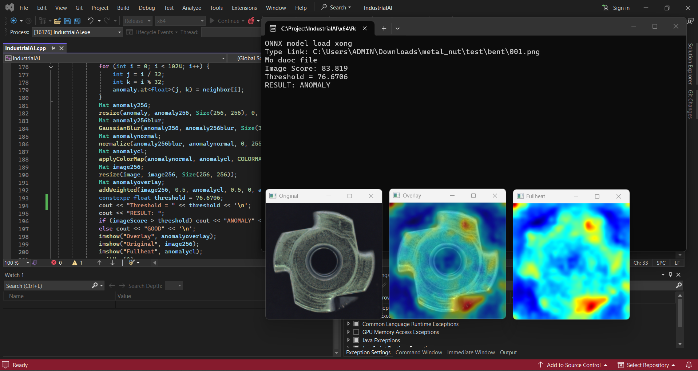

# Metal Nut Anomaly Detection using PatchCore

An image-based anomaly detection project for identifying defects in metal nuts using PatchCore, ONNX Runtime, and C++.

The project explores how deep learning-based feature extraction and distance-based anomaly detection can be applied to visual inspection tasks.

## Demo

[Watch the demonstration video](https://drive.google.com/file/d/1tYTPK982gbc4pCzoyvGLgsD2gqk7OVY9/view?usp=sharing)

## Results

The C++ application processes an input image and produces an anomaly score, a classification result, and an anomaly map highlighting potentially defective regions.

## Methodology

### 1. Dataset Preparation

This project uses the **Metal Nut** category from the MVTec Anomaly Detection (MVTec AD) dataset.

The dataset contains normal training images and test images consisting of both normal and defective samples.

- Training: 220 good images
- Testing: 22 good images
- Defective test images: 93
- Total test images: 115

The original dataset is not included in this repository. Please obtain it from the official source and comply with its license terms.

[View Dataset](dataset.png)

### 2. Feature Extraction

A pretrained CNN backbone extracts image features from two intermediate layers:

- `layer2`
- `layer3`

The extracted feature maps are resized and combined to form a feature representation for each image patch.

### 3. Memory Bank Construction

Features from normal training images are collected to construct a memory bank.

Coreset subsampling is applied to reduce the number of stored feature vectors while retaining representative information from the normal data.

### 4. Anomaly Detection

For each test image, the extracted patch features are compared with the memory bank using nearest-neighbor distance.

Higher distances indicate that a patch differs more from the normal training features.

The maximum patch anomaly score is used as the image-level anomaly score.

### 5. Anomaly Map Visualization

Patch-level anomaly scores are used to generate an anomaly map, which is overlaid on the original image to visualize potentially anomalous regions.

### 6. Threshold Selection and Evaluation

Python is used to evaluate image-level anomaly scores and select a classification threshold.

The selected threshold prioritizes high anomaly recall, with the trade-off of a higher false positive rate.

### 7. C++ Inference

The backbone is exported to ONNX and executed using ONNX Runtime.

The C++ application performs image preprocessing, feature extraction, nearest-neighbor comparison, anomaly scoring, classification, and visualization.

## Evaluation Results

The selected threshold was chosen to prioritize detecting defective samples.

| Metric | Result |
|---|---:|
| ROC AUC | 0.6349 |
| Threshold | 88.588196 |
| Anomaly Recall | 96.77% |
| False Positive Rate | 77.27% |
| Detected anomalies | 90 / 93 |
| Missed anomalies | 3 |

The evaluation was conducted on 115 test images. The high false positive rate indicates that many normal images were incorrectly classified as anomalous. These results reflect the current implementation and evaluation setup.

[View Python Results](python-results.png)

## Model Files

The C++ inference application uses the following files:

| File | Description |
|---|---|
| `patchcore_backbone.onnx` | CNN backbone for feature extraction |
| `memory_bank.bin` | Stored normal patch feature vectors |

The original PyTorch checkpoint (`.pth`) is not required by the current C++ inference application.

[View Model Files](model-files.png)

[Download memory_bank.bin](memory_bank.bin)

[Download patchcore_backbone.onnx](https://drive.google.com/file/d/1XLOI0bCrdDjUd9QXy5N0JNEBCKiGrbi8/view?usp=sharing)

## Requirements

- C++
- OpenCV
- ONNX Runtime
- Python
- NumPy
- PyTorch
- ONNX Runtime Python package

## How to Run

1. Install OpenCV and ONNX Runtime.
2. Place the ONNX model and memory bank files in the expected locations.
3. Configure the C++ project to link against the required libraries.
4. Build and run the C++ application.
5. Enter the path to an input image.
6. View the anomaly score, classification result, and anomaly map.

## Limitations

- The current evaluation uses a relatively small test set.
- The selected threshold produces a high false positive rate.
- Anomaly map visualization may contain artifacts and requires further refinement.
- Performance and generalization should be evaluated on additional data before practical deployment.

## Dataset Attribution

Paul Bergmann, Michael Fauser, David Sattlegger, and Carsten Steger,  
"A Comprehensive Real-World Dataset for Unsupervised Anomaly Detection,"  
IEEE Conference on Computer Vision and Pattern Recognition (CVPR), 2019.

**Dataset:** [MVTec Anomaly Detection Dataset](https://www.mvtec.com/company/research/datasets/mvtec-ad)

**License:** CC BY-NC-SA 4.0  
Copyright 2019 MVTec Software GmbH.

[Creative Commons Attribution-NonCommercial-ShareAlike 4.0 International](https://creativecommons.org/licenses/by-nc-sa/4.0/)
